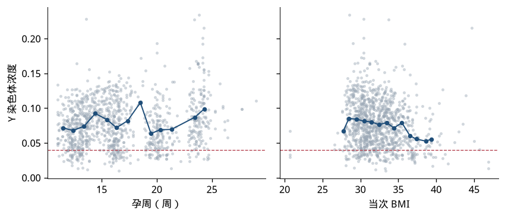
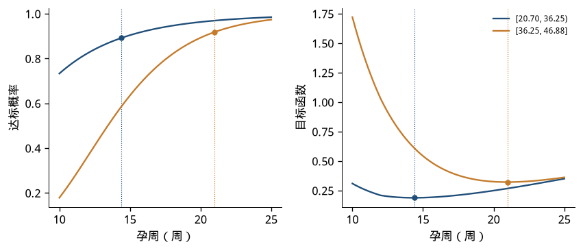
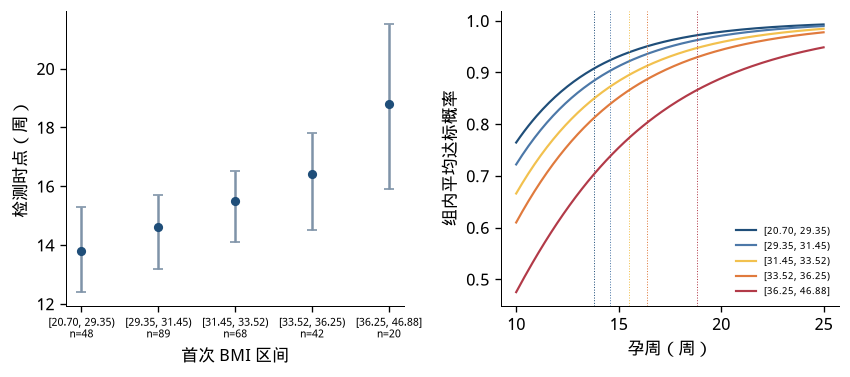
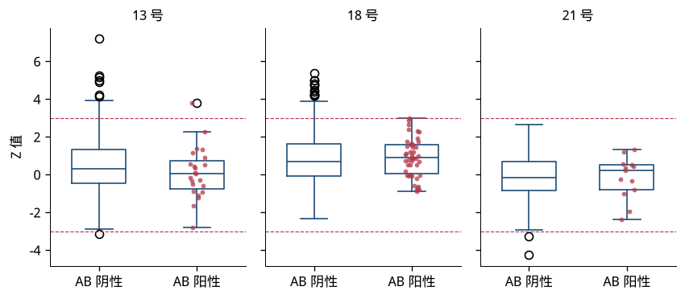

# NIPT 时点选择与胎儿异常判定：赛后修订研究

> 本文是对 2025 年高教社杯全国大学生数学建模竞赛 C 题的赛后方法修订与公开复现说明，不是竞赛官方提交版本，也未重新提交给全国大学生数学建模竞赛。历史参赛稿仍为仓库中的 `paper/final_paper.pdf`。文中全部数值均由 `src/revised/` 在本地官方附件上计算，原始工作簿不进入版本库。计算表见 `paper/tables/`。

## 摘要

男胎 Y 染色体浓度与孕周、BMI 的关系是存在的，但固定效应很弱。在 1082 次男胎检测、267 名孕妇上，孕周与 Y 浓度的行级 Pearson 相关为 0.127，BMI 与 Y 浓度的相关为 −0.151；聚类稳健的线性模型里，孕周每增加 1 周，Y 浓度约增加 0.0012，BMI 每增加 1 个单位约减少 0.0020。样本内线性 \(R^2\) 最高约 0.069，按孕妇分组的交叉验证 \(R^2\) 约 0.02。随机截距的标准差约 0.029，大于残差标准差 0.017。历史参赛稿中那种很高的拟合优度依赖了与 Y 浓度近乎循环的特征，本修订不沿用该结论。

最早达标时间按左删失、区间删失和右删失构造，不删除从未达标的孕妇。按首次检测的官方 BMI 做有序分割，BIC 选择两组：BMI 在 \([20.70, 36.25)\) 的 247 人，主风险下的检测时点为 14.4 周（孕妇抽样 95% 区间 13.0–15.7 周）；BMI 在 \([36.25, 46.88]\) 的 20 人，时点为 21.0 周（17.4–23.6 周）。题面举例的五档只作为基线。时点对风险权重 \(\lambda\) 敏感，对早、中、晚斜率在 1:2:4 到 1:4:8 之间的变化不敏感。

多因素模型仍只输出连续的 BMI 区间和每组一个时点。BMI 每增加 1 个单位，对数达标时间的斜率约为 0.037，年龄和身高的区间覆盖 0。交叉验证风险从 2 组到 5 组只下降约 0.001，预先登记的最小值规则给出 5 组，时点由 13.8 周逐渐移到 18.8 周。这不是检测失败后的复检方案。

女胎只使用女胎表，标签是 AB 列而不是出生结局。女胎出生结局全部为「是」，不能作为阳性标签。经典规则 \(|Z|\ge 3\) 对 T13、T18、T21 的敏感度分别为 0.043、0 和 0。逻辑回归的分组交叉验证 AUC 约为 0.70–0.81；为了接近 0.95 的敏感度，特异度降到 0.24–0.55。高特异度的 Z 值双阈值在交叉验证中没有抓住 AB 阳性行。因此本文给出的是可核对的判定比较，而不是一条可以直接替代实验室报告的临床规则。

**关键词：** 无创产前检测；区间删失；线性混合模型；BMI 有序分组；女胎非整倍体

## 1 修订说明与问题重述

本题要求分析男胎 Y 染色体浓度与孕周、BMI 的关系，再按 BMI 给出 NIPT 时点，使潜在风险较小，并在女胎上以染色体非整倍体（AB 列）判定异常。检测窗口通常为孕 10–25 周。题面把发现不健康胎儿的时间风险分为三个阶段：12 周以内较低，13–27 周较高，28 周以后极高。Y 浓度达到或超过 4% 时，认为男胎检测结果基本可靠。4% 在数据中对应比例 0.04。

历史参赛稿和 `src/problem1_ridge_regression.py` 至 `src/problem4_female_anomaly_detection.py` 保留为当时实现的对照，本修订不改写它们的计算。需要分开看的主要问题是：问题一使用了 Y 染色体 Z 值、X 浓度、非整倍体和出生结局来解释 Y 浓度；问题二把从未达标的孕妇删去，并把时点搜索绑在预设周附近；问题三把达标时间本身放进聚类特征，并把题目改写成初次失败后的补检；问题四在论文表述中使用了出生结局，代码则用 Y 浓度阈值筛「女胎」。这些做法不再作为修订研究的结果。

本修订的目标仍是官方四问。它不把模型推广为先兆子痫或其他妊娠结局的预警工具。数据来自竞赛官方附件，只在本地读取；仓库不提供该文件。

## 2 数据、定义与预处理

官方工作簿有两张表，没有第三张表。本次读入的结果是：

| 工作表 | 检测行数 | 孕妇数 | 代码 |
| --- | ---: | ---: | --- |
| 男胎检测数据 | 1082 | 267 | A001–A267 |
| 女胎检测数据 | 605 | 147 | B001–B147 |

两表孕妇代码没有交集。男胎、女胎按工作表名称区分，不用 \(Y\le 0.08\)。女胎表第 21、22 列没有表头，Y 染色体 Z 值和 Y 浓度全部为空。男胎「唯一比对的读段数」列表头带有尾随空格，读取时去掉首尾空格后再对应到同一字段。

孕周字符串统一解析为「周 + 天/7」。`11w+6` 是 \(11+6/7\) 周，不是 83 天。男胎和女胎的孕周都能解析，没有跨人插补。男胎 Y 浓度没有缺失，最小 0.010，中位 0.075，最大 0.234；低于 0.04 的有 145 行，不低于 0.04 的有 937 行。X 浓度允许为负：男胎 74 行，女胎 405 行。

BMI 使用官方 K 列。用体重（kg）和身高（cm）按 \(\mathrm{BMI}=\text{体重}/(\text{身高}/100)^2\) 重算后，男胎最大绝对差为 0.0022，女胎有官方 BMI 的行最大绝对差约为 \(5\times 10^{-9}\)。女胎有 1 行官方 BMI 缺失，用同一公式补上，并单独标记。分组不使用每次检测各自的 BMI：248/267 名男胎孕妇的 BMI 在多次检测间发生变化，仅 5 人身高有变化。问题二、问题三的分组 BMI 预先规定为**首次检测**的官方 BMI。问题一描述当次浓度，使用**当次**官方 BMI。

同一孕妇、同一次抽血次数的多行视为同一次抽血的重复测序。构造最早达标时间时，该次抽血的 Y 取中位数，孕周取中位数，避免把重复上机当成两个孕周。男胎有 40 组这样的重复抽血。测量误差的主尺度是这些重复测序的合并标准差，本次为 0.0061。没有单独的测序失败标志列，因此不另造一个失败标签，也不为了「清洗」删除 GC、年龄或低浓度记录。男胎没有年龄低于 20 岁的行，女胎有 1 行；两行都不因法定婚龄被删除。

AB 列是 `T13`、`T18`、`T21` 及其并写，空白表示该次检测没有报出这些非整倍体。并写同时计入所含染色体。女胎中含 T13、T18、T21 的行数分别为 23、46、13，AB 非空共 67 行。女胎「胎儿是否健康」全部为「是」，所以出生结局在女胎上没有阳性类，不能当作问题四的标签。女胎有 44 人至少一次 AB 非空，其中 43 人的 AB 在各次检测之间发生变化。因此问题四的标签是**这一次检测的 AB**，交叉验证则按孕妇整组划分，避免同一人的多次检测分到训练和测试两侧。

最早达标时间按孕妇、按抽血中位数序列定义，阈值 0.04：

- 第一次抽血已经不低于 0.04：左删失，只知道达标不晚于该孕周；
- 在相邻两次抽血之间第一次达到：区间删失 \((t_{j-1}, t_j]\)；
- 直到末次仍未达到：右删失，保留在样本中。

在上述中位数规则下，267 名男胎孕妇中左删失 217 人，区间删失 43 人，右删失 7 人；32 人在首次达到之后的某次抽血又低于 0.04。首次达标时间仍取第一次达到，不因后来回落而改写。左删失占多数，说明很多孕妇在进入观测时已经超过 4%，对数正态模型的中位数可以落在首次采血之前。下面报告的检测时点是临床窗口内风险目标的最小值，不是把左删失端点当成精确达标周，也不是模型的中位数本身。

## 3 符号、模型与预先登记的选择

记孕妇 \(i\) 的第 \(j\) 次检测孕周为 \(t_{ij}\)（单位：周），当次 Y 浓度为 \(Y_{ij}\)，当次 BMI 为 \(B_{ij}\)，首次 BMI 为 \(B_i^{(1)}\)。\(T_i\) 是 \(Y\) 第一次达到 0.04 的孕周，观测为删失区间。

问题一的主模型只使用孕周、BMI、年龄、IVF（辅助生殖相对自然受孕）以及 GC 含量、比对比例。Y 染色体 Z 值、X 浓度、AB 和出生结局不进入该模型。嵌套顺序是：只有孕周；孕周加 BMI；再加上交互；再加上上述协变量。显著性以孕妇为聚类的稳健标准误为主，并用孕妇随机截距的线性混合模型描述重复测量。随机斜率只作补充。预测性能用按孕妇的 GroupKFold，标准化和岭回归的惩罚都只在训练折上拟合。岭回归不是主结果。平方项只做弯曲检查，不进入主系数表。随机截距的主模型再用 bfgs 和共轭梯度各拟合一次，只核对方差分量是否随优化器改变。

问题二、问题三的主风险不是单独的「失败权重」。时间风险采用分段线性累积

\[
r(t)=1\cdot B_E(t)+3\cdot B_M(t)+6\cdot B_L(t),
\]

\[
B_E(t)=\min(t,12),\quad B_M(t)=\max(\min(t,28)-12,0),\quad B_L(t)=\max(t-28,0),
\]

再归一化到 \([0,1]\)：

\[
\mathrm{Risk}(t)=\mathrm{clip}\left(\frac{r(t)-r(10)}{r(40)-r(10)};0,1\right).
\]

尚未达标进入 \(-\log\pi(t)\)。主目标是

\[
J(t)=-\log\pi(t)+\lambda\,\mathrm{Risk}(t),\qquad \lambda=1,
\]

\(t\) 在 \([10,25]\) 上周步长 0.1 的网格上最小化。\(\pi(t)\) 在问题二中是组内区间删失对数正态的分布函数，在问题三中是组内个体达标概率的平均。斜率比 \(1{:}2{:}4\)、\(1{:}3{:}6\)、\(1{:}4{:}8\) 和 \(\lambda\in\{0.5,1,2\}\) 构成预先写好的敏感性网格。1:3:6 与 \(\lambda=1\) 是主设定。

分组只在 BMI 上做有序分割，每组至少 20 人，候选切点只放在 BMI 发生变化的位置。问题二用组内区间删失似然的 BIC 选择 2 至 5 组，参数个数按每组 2 个分布参数再加 \(K-1\) 个切点计算。问题三用五折 GroupKFold 的平均留出风险选择 \(K\)。题面中的 \([20,28)\)、\([28,32)\)、\([32,36)\)、\([36,40)\)、\(\ge 40\) 只作为基线；样本中没有 BMI 低于 20 的男胎孕妇，第一档的观察范围从实际最小值写起。

问题三的主达标时间模型是

\[
\log T_i=\beta_0+\beta_B B_i^{(1)}+\beta_A\mathrm{Age}_i+\beta_H\mathrm{Height}_i+\sigma\varepsilon_i.
\]

BMI 已经包含身高和体重的比例信息，主模型不再同时放入体重。敏感性模型改为年龄、身高和体重，不再放入 BMI。浓度模型另外拟合随机截距，用来对照「当次 Y 超过 0.04 的概率」，不替换首次达标概率。检测误差分析只对 Y 加 \(N(0,0.0061^2)\) 的噪声并重算删失区间，分组保持不变。时点区间来自按孕妇有放回抽样的百分位区间，问题二、问题三各 200 次；测量误差各 100 次。

问题四先报告 \(|Z|\ge 3\)。主模型是未做类别平衡的 L2 逻辑回归，惩罚系数固定为 1，不在测试集上选模型。概率阈值只在训练折上选取：在敏感度至少为 0.95 的阈值中取特异度最高的一个。质量分层的双阈值也只在训练折的阴性样本上，按 99% 与 99.5% 特异度取 Z 的分位数，低于较低阈值视为阴性区，两者之间为观察区，不低于较高阈值视为阳性区。全样本逻辑回归只解释系数，使用孕妇聚类稳健标准误，不对特征做全样本标准化，也不用它选择阈值。

## 4 问题一：浓度、孕周与 BMI

分析样本是全部 1082 行男胎检测，267 名孕妇，没有因缺失主变量而删除行。协变量在各自样本均值处中心化：孕周 16.85 周，BMI 32.29，年龄 28.94 岁，GC 0.401，比对比例 0.797。因此孕周系数是平均 BMI 处的斜率，BMI 系数是平均孕周处的斜率。

行级相关和按孕妇重抽样的 95% 区间如下。区间不包含 0。

| 变量对 | Pearson | Spearman | Kendall |
| --- | --- | --- | --- |
| 孕周与 Y | 0.127（0.054, 0.207） | 0.084（0.017, 0.162） | 0.059（0.016, 0.112） |
| BMI 与 Y | −0.151（−0.252, −0.035） | −0.155（−0.251, −0.050） | −0.105（−0.170, −0.033） |
| 年龄与 Y | −0.119（−0.225, −0.011） | −0.117（−0.221, −0.010） | −0.082（−0.153, −0.008） |
| BMI 与孕周 | 0.150（0.083, 0.212） | 0.137（0.074, 0.200） | 0.093（0.051, 0.138） |

孕妇均值之间的 Spearman 相关方向并不完全相同：平均孕周与平均 Y 为 −0.287，平均 BMI 与平均 Y 为 −0.221，排列检验的 \(p\) 都是 999 次下的最小值 0.001；平均年龄与平均 Y 为 −0.127，\(p=0.037\)。孕周在行级为正、在孕妇均值上为负，与 BMI 的结构一致：BMI 较高的孕妇检测更晚，而 BMI 本身与 Y 浓度相反。所以不能把孕妇平均值的负相关理解成「孕周越长浓度越低」。混合模型里的孕周斜率是控制 BMI 和孕妇差异之后的方向。

图 1 是这 1082 次检测。灰点是原始记录，折线是宽度为 1 的分箱均值，箱内少于 8 次的不画，红色虚线是 0.04。孕周的折线上下波动，不是随孕周稳定上升；BMI 从 28 附近到 40 附近的箱均值大体下降，更高 BMI 的箱人数很少。分箱的人数和均值在 `paper/tables/problem1_bins.csv`。这张图只说明原始散点很散，不能代替下面控制 BMI 之后的斜率。



聚类稳健普通最小二乘的主要系数：

| 模型 | 孕周（每周） | BMI（每单位） | 样本内 \(R^2\) | 分组交叉验证 \(R^2\) |
| --- | --- | --- | ---: | ---: |
| 仅孕周 | 0.00104（\(p=0.0014\)） | — | 0.016 | 0.007 |
| 孕周 + BMI | 0.00126（\(p=5.8\times 10^{-5}\)） | −0.00196（\(p=0.0035\)） | 0.046 | 0.010 |
| 主模型 | 0.00118（\(p=1.7\times 10^{-4}\)） | −0.00200（\(p=0.0018\)） | 0.069 | 0.020 |

主模型中，孕周与 BMI 的交互项为 \(7.9\times 10^{-5}\)（\(p=0.47\)），年龄为 −0.00105（\(p=0.039\)），辅助生殖与 GC 的区间都覆盖 0。比对比例的聚类稳健系数为 −0.201（\(p=0.004\)），但在下面的混合模型中不再明显，因此不把它写成稳定结论。加法协变量的方差膨胀因子都在 1.01 到 1.03 之间。岭回归使用同一组主模型特征，分组交叉验证 \(R^2\) 为 0.022，只说明惩罚回归没有带来可用的预测增益。

随机截距模型的孕周斜率更大：主模型中为每周 0.00313，BMI 斜率为 −0.00149（\(p=0.0047\)）。交互项的似然比检验 \(\chi^2=1.83\)，\(df=1\)，\(p=0.18\)；再加入年龄、IVF、GC 和比对比例的似然比检验 \(p=0.094\)。随机截距标准差为 0.0287，残差标准差为 0.0171，二者方差中随机截距约占 74%。固定效应的边际 \(R^2\) 接近 0。允许孕周随机斜率后，斜率标准差约为 0.0026，残差标准差降到 0.0135；这只说明孕妇之间的孕周斜率有差异，不改变「固定效应弱、个体差异强」的主结论。把主模型的随机截距设定分别用 lbfgs、bfgs 和共轭梯度拟合，随机截距标准差都是 0.0287，残差标准差都是 0.0171，三者极差小于 \(2\times 10^{-6}\)。三种拟合都提示极大似然可能靠近参数空间的边界，但两个方差分量都不在 0 上。系数解释仍以聚类稳健的最小二乘和这组方差分量为准。

在只有孕周和 BMI 线性项的模型上再加入两者的平方项，聚类稳健的联合 Wald 检验为 \(\chi^2=7.83\)，\(df=2\)，\(p=0.020\)。孕周平方项为 \(1.31\times 10^{-4}\)（\(p=0.016\)），区间不覆盖 0；BMI 平方项为 \(-1.47\times 10^{-4}\)（\(p=0.24\)），区间覆盖 0。离开孕周均值 5 周时，平方项系数乘以 \(5^2\) 约为 0.0033，线性项系数乘以 5 约为 0.0048。弯曲集中在孕周，相对 Y 浓度约 0.034 的标准差仍然有限。主系数表不改用平方项，平方项只是这项检查。

因此，问题一的结论是方向和量级，不是高 \(R^2\)：在平均协变量附近，孕周与 Y 浓度同向，BMI 与 Y 浓度反向，效应相对 Y 浓度约 0.034 的标准差是小的；对新孕妇的浓度预测很弱。历史稿把含有 Y 的 Z 值等变量的拟合优度当作关系模型的证据，本修订不使用那一组数字。

## 5 问题二：BMI 区间与检测时点

267 名孕妇都进入删失样本。有序分割的 BIC 为：2 组 381.0，3 组 391.6，4 组 404.7，5 组 417.8。主分组是 2 组。

| BMI 区间 | 人数 | 左 / 区间 / 右删失 | 时点（周） | 抽样区间 | 测量误差区间 | 该时点达标概率 |
| --- | ---: | --- | ---: | --- | --- | ---: |
| \([20.70, 36.25)\) | 247 | 208 / 33 / 6 | 14.4 | 13.0–15.7 | 14.0–15.4 | 0.892 |
| \([36.25, 46.88]\) | 20 | 9 / 10 / 1 | 21.0 | 17.4–23.6 | 18.8–22.5 | 0.919 |

两个时点都落在该组已经观测到的孕周范围内，不是搜索区间的端点。低 BMI 组在 12、16、20、24 周的模型达标概率分别为 0.824、0.922、0.964、0.982；高 BMI 组为 0.363、0.708、0.893、0.965。14.4 周并不是低 BMI 组「几乎人人达标」的位置，而是再等待所增加的达标概率已经抵不过继续上升的时间风险。高 BMI 组人数只有 20，区间明显宽于低 BMI 组。图 2 是这两组在 10–25 周网格上的达标概率和目标函数，竖线是上表的时点。低 BMI 组的目标函数在 14.4 周附近最低，高 BMI 组在 21.0 周附近最低。网格上的取值在 `paper/tables/problem2_curves.csv`。



同一次抽血重复测序的噪声较小。把 Y 加上标准差 0.0061 的扰动后，两组时点的波动窄于孕妇抽样区间，所以这里的主要不确定性是样本抽样，不是这条技术重复尺度。敏感性网格里，斜率比几乎不改变 \(\lambda=1\) 的时点（低 BMI 组 14.3 或 14.4 周，高 BMI 组 20.9 或 21.0 周）。\(\lambda\) 会移动时点：低 BMI 组在 \(\lambda=0.5,1,2\) 时约为 17.4、14.4、12.0 周，高 BMI 组约为 23.4、21.0、18.4 周。主结果依赖预先登记的 \(\lambda=1\)，不应理解成与权重无关的唯一周数。两组的先后顺序在整个网格上保持不变。

题面五档按首次 BMI 的人数是 5、147、95、16、4，对应时点点估计 15.4、14.7、13.7、20.6、22.6 周。最低组的抽样区间是 10.0–16.6 周，最高组是 10.0–25.0 周，也就是搜索窗口的两端都能出现。\([32,36)\) 这一档的对数时间位置参数落在预设下界 \(\log 6\) 上，它比相邻较低 BMI 档更早的点估计不能当作稳定的反向梯度。五档表说明高 BMI 端点估计更晚，但不能代替有序分割的主结果，也不能把小样本的点估计写成精确到小数点后很深的临床时点。

## 6 问题三：多因素之后的 BMI 时点

问题三仍然回答「按 BMI 分组，每组一个时点」。达标比例是个体首次达标概率的组内平均，不是历史上某次检测是否达标的计数，也不是复检成功率。

在 267 名信息完整的孕妇上，对数达标时间对首次 BMI 的斜率为 0.037，200 次孕妇抽样的区间是 0.006–0.062，不覆盖 0。年龄斜率 0.003（−0.026–0.031），身高斜率 0.008（−0.009–0.029），都覆盖 0。对数时间的尺度为 0.529（0.401–0.641）。BMI、年龄、身高的方差膨胀因子约为 1.01–1.02。把 BMI 换成身高加体重后，AIC 从 371.0 变为 370.5，几乎没有差别；身高与体重的方差膨胀因子约为 1.6。预先登记的主模型仍是 BMI、年龄和身高。体重模型里，体重斜率符号为正、身高斜率为负，与「更重则更晚、固定体重时更高则 BMI 更低」的方向一致，但不改变分组轴。BMI 仍是分组变量，因为题目要求按 BMI 给出区间。

五折留出风险的平均值是：2 组 0.206，3 组 0.205，4 组 0.205，5 组 0.205。按预先登记的最小留出风险，记录的组数是 5。下降幅度约 0.001，所以组数并没有被数据尖锐地识别。五组的主时点是：

| BMI 区间 | 人数 | 时点（周） | 抽样区间 | 测量误差区间 | 达标概率 | 浓度模型对照时点 |
| --- | ---: | ---: | --- | --- | ---: | ---: |
| \([20.70, 29.35)\) | 48 | 13.8 | 12.4–15.3 | 13.1–14.9 | 0.908 | 13.4 |
| \([29.35, 31.45)\) | 89 | 14.6 | 13.2–15.7 | 14.0–15.5 | 0.904 | 14.8 |
| \([31.45, 33.52)\) | 68 | 15.5 | 14.1–16.5 | 15.0–16.3 | 0.895 | 16.3 |
| \([33.52, 36.25)\) | 42 | 16.4 | 14.5–17.8 | 15.5–17.2 | 0.887 | 17.8 |
| \([36.25, 46.88]\) | 20 | 18.8 | 15.9–21.5 | 16.8–20.4 | 0.865 | 20.4 |

浓度模型对照使用当次 Y 的随机截距模型，在同一组固定切点上计算 \(P(Y(t)\ge 0.04)\)。它与首次达标模型的时点接近，高 BMI 端相差约 1.6 周。两种概率不是同一个定义：前者是某孕周的浓度超过阈值，后者是首次超过阈值的时间不晚于该孕周。主结果用后者。图 3 左边是五组时点和孕妇抽样区间，右边是组内平均首次达标概率。BMI 越高，曲线越靠右，人数为 20 的高 BMI 组区间也最宽。曲线在 `paper/tables/problem3_curves.csv`。



若只看留出风险几乎相同的 2 组分割，则 BMI 在 \([20.70, 33.52)\) 的 205 人时点为 14.7 周，其余 62 人为 17.2 周。3 组和 4 组也保持「BMI 越高、时点越晚」。因此问题三相对问题二的新增信息，是年龄和身高没有稳定的独立斜率，而 BMI 的梯度在更细的区间上仍然单调；不是五条切点具有唯一性，也不是失败后何时复检。

## 7 问题四：女胎 AB 的判定比较

女胎 605 行、147 人全部进入各自特征完整的样本；本题特征没有造成额外删行。标签按染色体拆开。\(|Z|\ge 3\) 没有需要估计的阈值，直接在全部行上计算。

| 任务 | 阳性行 | \(|Z|\ge 3\) 的敏感度 | 特异度 | 真阳性 | 假阳性 | 假阴性 |
| --- | ---: | ---: | ---: | ---: | ---: | ---: |
| T13 | 23 | 0.043 | 0.967 | 1 | 19 | 22 |
| T18 | 46 | 0 | 0.941 | 0 | 33 | 46 |
| T21 | 13 | 0 | 0.997 | 0 | 2 | 13 |
| 任一 AB | 67 | 0.060 | 0.924 | 4 | 41 | 63 |

经典阈值与 AB 标签严重错位。它仍然必须先报告，否则无法判断后面的模型是否真有增益。阳性行的 Z 值也没有堆在 3 的一侧。下表是同一 605 行按标签拆开的分布，图 4 中阳性行是散点，阴性行是箱线，虚线为 ±3。18 号阳性 46 行的最大 Z 值是 2.974，21 号阳性 13 行的最大 Z 值是 1.329，都没有到达 3；13 号和 18 号上越过 3 的点多数来自 AB 阴性。

| 染色体 | 标签 | 行数 | 中位数 | 最小值 | 最大值 | \(\|Z\|\ge 3\) |
| --- | --- | ---: | ---: | ---: | ---: | ---: |
| T13 | 阴性 | 582 | 0.308 | −3.143 | 7.194 | 19 |
| T13 | 阳性 | 23 | 0.040 | −2.807 | 3.808 | 1 |
| T18 | 阴性 | 559 | 0.688 | −2.313 | 5.381 | 33 |
| T18 | 阳性 | 46 | 0.900 | −0.904 | 2.974 | 0 |
| T21 | 阴性 | 592 | −0.144 | −4.256 | 2.662 | 2 |
| T21 | 阳性 | 13 | 0.202 | −2.394 | 1.329 | 0 |



逻辑回归按孕妇做五折 GroupKFold。训练折内标准化，并在训练折上按目标敏感度 0.95 取阈值。合并测试折的结果是：

| 任务 | AUC | 敏感度 | 特异度 | 阳性预测值 | Brier |
| --- | ---: | ---: | ---: | ---: | ---: |
| T13 | 0.761 | 0.913 | 0.497 | 0.067 | 0.034 |
| T18 | 0.812 | 0.935 | 0.286 | 0.097 | 0.057 |
| T21 | 0.699 | 0.846 | 0.547 | 0.039 | 0.020 |
| 任一 AB | 0.757 | 0.940 | 0.238 | 0.133 | 0.084 |

T21 没有达到 0.95 的敏感度，表中是训练折规则下能达到的结果。AUC 高于无信息的 0.5，说明特征整体上有一定排序能力；但在高敏感度处，特异度和阳性预测值都很低。阳性行本身很少，T21 的折间 AUC 标准差为 0.14，单次划分的指标会波动。

全样本、未标准化的聚类稳健逻辑回归里，只有 T18 的 Z 系数明显偏离 0：0.348，95% 区间 0.093–0.602，\(p=0.007\)，优势比 1.42。T13 的 Z 系数为 0.085（\(p=0.72\)），T21 为 0.194（\(p=0.32\)），区间都覆盖 0。原始读段数的对数和唯一比对读段数的方差膨胀因子约为 23，这两个质量系数不宜分开解释。X 浓度的原始刻度很小，其系数的绝对值很大，不能按「每变化 1 个单位」理解成临床分数；本文不把任何一个未预先登记的切点提升为判定规则。

按训练折 99% 与 99.5% 特异度做成的阴性区、观察区和阳性区，在合并的测试折上对三条染色体的阳性区敏感度都是 0，观察区并入后仍是 0。也就是说，为了把假阳性压到大约 1% 以下，这批女胎 AB 阳性行的 Z 值并没有进入阳性区。一次 30% 孕妇留出只用来展示阈值长什么样，性能以上面的交叉验证为准。

问题四的可执行结论因此是一条否定性的比较：不能用 \(|Z|\ge 3\) 复现本附件女胎表上的 AB；逻辑回归有中等区分度，但在预先登记的高敏感度目标下不能同时保持高特异度。质量分层的高特异度 Z 值区域在本数据上没有检出 AB 阳性。AB 又会在同一孕妇的多次检测之间翻转，所以这里的模型描述的是「这一次检测报告的 AB」，不是出生诊断，也不是稳定的个人标签。

## 8 讨论与限度

四问可以收成三句话。第一，孕周和 BMI 与男胎 Y 浓度的方向是稳定的，个体之间的随机差异大于这条平均曲线，新孕妇的浓度预测 \(R^2\) 大约只有 0.02。第二，在预先登记的风险下，更高的首次 BMI 对应更晚的检测时点；问题二的数据支持在 BMI 约 36.3 处分成两大组，问题三说明把组再切细只能让留出风险下降约 0.001。第三，女胎 AB 不是 \(|Z|\ge 3\) 的标签，出生结局在女胎表上又没有阳性，复杂分类器的 AUC 不能代替这条核对。

限度也是结果的一部分。左删失占男胎孕妇的 81%，对数正态的中位数可以早于首次采血，临床时点只在 10–25 周内比较风险。高 BMI 组只有 20 人，区间宽。\(\lambda\) 从 0.5 改到 2，时点可以移动数周。测量误差使用的是同一次抽血的重复测序，标准差 0.0061，小于浓度模型的残差；它不能代表所有未观测的临床不确定性。问题三的 5 组切点是最小留出风险的记录，不是唯一的临床分层。问题四没有外部产前诊断金标准，AB 与 Z 值的不一致本身就是数据事实，不能靠调阈值消掉。

本修订没有做无说明的删行、过采样或全样本标准化，也没有把达标时间放进分组特征。图 1 至图 4 与正文的表来自同一次运行。历史脚本仍可用来对照旧稿，但它们的输出不是本文的表。附件受竞赛版权保护，复现时需要自行放在仓库根目录的 `附件.xlsx`，并且不要提交。

## 9 参考文献

下列文献取自历史参赛稿中与论述相符、并且可以按原文条目核对的部分。附件本身不再列为文献。稿中条目不完整的一篇没有沿用。组委会讲评只作为第 3 节风险函数形状的方法来源，文中没有引用其示例切点、时点或系数。

1. 2025 年高教社杯全国大学生数学建模竞赛 C 题题目.
2. Lo Y M D, Corbetta N, Chamberlain P F, et al. Presence of fetal DNA in maternal plasma and serum. The Lancet, 1997, 350(9076): 485–487. https://doi.org/10.1016/S0140-6736(97)02174-0
3. Fan H C, Quake S R. Sensitivity of noninvasive prenatal detection of fetal aneuploidy from maternal plasma using shotgun sequencing is limited only by counting statistics. PLoS One, 2010, 5(5): e10439. https://doi.org/10.1371/journal.pone.0010439
4. Ashoor G, Syngelaki A, Wagner M, et al. Fetal fraction in maternal plasma cell-free DNA at 11–13 weeks' gestation: relation to maternal and fetal characteristics. Ultrasound in Obstetrics & Gynecology, 2012, 41(1): 26–32. https://doi.org/10.1002/uog.12331
5. Wang E, Batey A, Struble C, et al. Gestational age and maternal weight effects on fetal cell-free DNA in maternal plasma. Prenatal Diagnosis, 2013, 33(7): 662–666. https://doi.org/10.1002/pd.4119
6. 全国大学生数学建模竞赛组委会，崔恒建. 2025 年全国赛题讲评（C 题部分所在的公开讲评材料）. 中国大学生在线，2025-12-02. https://dxs.moe.gov.cn/zx/a/hd_sxjm_sxjmstjp_2025sxjmstjp/251202/2025781.shtml

## 附录 复现

在仓库根目录放置本地的 `附件.xlsx` 后运行：

```bash
python -m src.revised.run_analysis
```

默认使用 999 次相关重抽样、200 次时点抽样和 100 次测量误差扰动，种子为 2025。单元测试不读取该工作簿：

```bash
python -m pytest -q tests
python -m compileall -q src
```

主要输出：

| 文件 | 内容 |
| --- | --- |
| `paper/tables/problem1_correlations.csv` | 相关与区间 |
| `paper/tables/problem1_coefficients.csv` | 聚类稳健系数 |
| `paper/tables/problem1_cv.csv` | 样本内与分组交叉验证 \(R^2\) |
| `paper/tables/problem1_models.json` | 混合模型、似然比、平方项检验、优化器对照和方差膨胀因子 |
| `paper/tables/problem1_bins.csv` | 孕周、BMI 的分箱均值 |
| `paper/tables/problem2_curves.csv` | 问题二主分组的达标概率与目标函数 |
| `paper/tables/problem3_curves.csv` | 问题三主分组的达标概率与目标函数 |
| `paper/figures/` | 图 1 至图 4 |
| `paper/tables/problem2_groups.csv` | 问题二主分组 |
| `paper/tables/problem2_official_bins.csv` | 五档基线 |
| `paper/tables/problem2_sensitivity.csv` | 斜率与 \(\lambda\) 网格 |
| `paper/tables/problem3_groups.csv` | 问题三主分组 |
| `paper/tables/problem3_models.json` | 达标时间模型、其他组数和浓度模型 |
| `paper/tables/problem4_baseline.csv` | Z 值规则与分区规则 |
| `paper/tables/problem4_cv.csv` | 逻辑回归交叉验证 |
| `paper/tables/problem4_coefficients.csv` | 聚类稳健逻辑回归系数 |
| `paper/tables/problem4_z_by_ab.csv` | 女胎 Z 值按 AB 标签的分布 |
| `paper/tables/sample_notes.json` | 样本量、删失和 AB 计数 |

`results/revised/` 是同一次运行的副本，已被忽略。历史参赛脚本仍是 `src/problem1_ridge_regression.py`、`src/problem2_optimal_timing.py`、`src/problem3_clustering_optimization.py` 和 `src/problem4_female_anomaly_detection.py`。

`paper/revised_study.pdf` 由本 Markdown 导出，不覆盖 `paper/final_paper.pdf`。在 `paper/` 目录下使用：

```bash
pandoc revised_study.md -o revised_study.pdf \
  -f markdown+tex_math_single_backslash+pipe_tables \
  --pdf-engine=xelatex \
  -V documentclass=ctexart \
  -V CJKmainfont="WenQuanYi Micro Hei" \
  -V geometry:a4paper \
  -V geometry:margin=2.2cm \
  -V fontsize=11pt
```

本次 PDF 用 pandoc 与 XeLaTeX（ctexart，文泉驿微米黑）从上面的命令生成。
